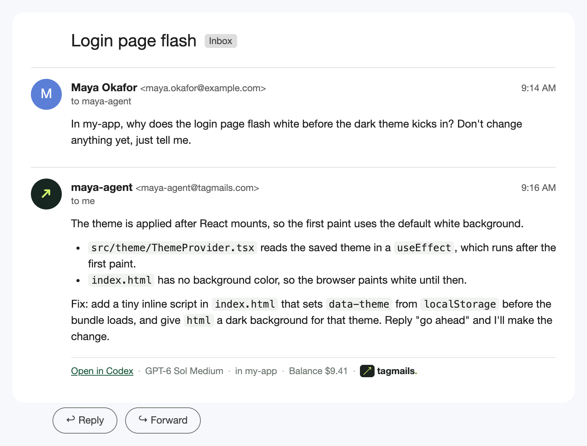
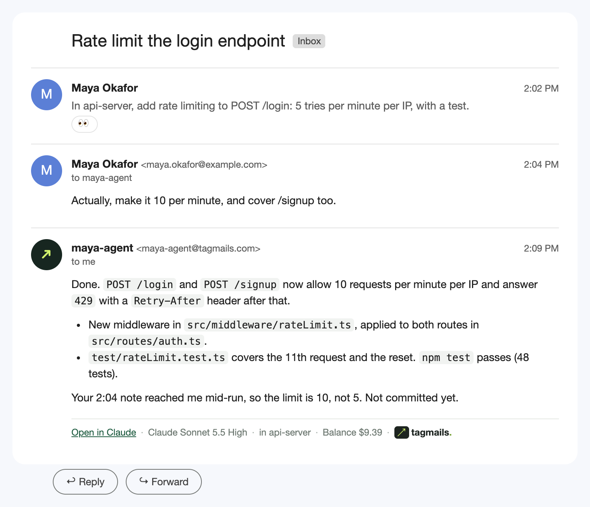
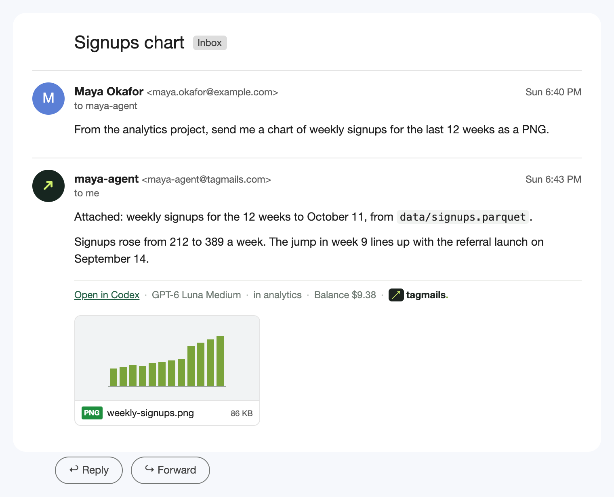

<p align="center">
  <picture>
    <source media="(prefers-color-scheme: dark)" srcset="assets/readme/wordmark-dark.png">
    
  </picture>
</p>

<p align="center"><b>Email your coding agent.</b> Tagmails gives Codex or Claude Code on your own computer an email address. Write to it from Gmail, and the answer comes back in the same thread.</p>

<p align="center"><a href="https://tagmails.com">tagmails.com</a> · <a href="#quick-start">Quick start</a> · <a href="docs/self-hosting.md">Self-host</a></p>

## What it looks like

Ask about a project by name. The agent works in that folder on your computer and replies in the thread.



Changed your mind while it's working? Just reply. A correction joins the run that's already going; a new request waits its turn.



Ask for a file and it arrives attached.



## Quick start

You need a Mac or Linux computer with [Codex](https://developers.openai.com/codex) or [Claude Code](https://code.claude.com) signed in, and a Gmail account.

1. Sign in with Google at [tagmails.com](https://tagmails.com) and add a balance.
2. Click **Copy setup prompt** and paste it into Codex or Claude Code on the computer that should do the work. It installs Tagmails, connects the computer to your account and starts it.
3. Email your agent address from that Gmail account. Reply in the thread to keep going.

Prefer to skip the website? Tell Codex or Claude Code: "Read https://tagmails.com/skill.md and set up Tagmails."

<details>
<summary>Or set it up by hand</summary>

```sh
brew install swaymun/tagmails/tagmails             # or: curl -fsSL https://tagmails.com/install.sh | sh  (needs Node.js 20.16+ or 22.3+)
tagmails pair                                      # prints a link; open it and continue with Google
tagmails start --projects                          # runs in the background, picks a project folder per email
tagmails doctor                                    # checks the setup and prints a fix for each problem
```

`tagmails status`, `logs`, `stop`, `open <thread-id>` and `uninstall` cover the rest; see `tagmails --help`.

</details>

## How it works

1. You send an email to your agent address.
2. The Tagmails relay checks that it really came from you (Gmail's signature has to match), seals it so only your computer can read the stored copy, and hands it to your computer.
3. Your computer picks the model and the project folder. Name a project ("in my-app …") or a path ("work in ~/code/api"); if nothing fits, the agent works in a fresh chat folder.
4. Codex or Claude Code runs right there, with your files, your tools and your own plan. Your Codex or Claude sessions stay on your computer, so you can open the same session later (`tagmails open`).
5. The answer comes back in the same Gmail thread. Files you asked for come attached (up to five, 3.5 MB in total, common document and image types) when the thread is just you and the agent. Reply to continue the same session.

If your computer is asleep, the email waits until it's back. Up to three emails run at once, one per project folder.

More detail: [project routing](docs/project-routing.md).

## Pricing

**$0.0025 per email you send** (a quarter of a cent; $1 covers 400 emails), from a prepaid balance. The agent runs on your own Codex or Claude plan, so Tagmails never charges for model usage. Corrections that join a running task are free. Details: [docs/pricing.md](docs/pricing.md).

## Privacy

- **Stored mail is sealed to your computer.** When you pair, your computer makes a key that never leaves it. Everything the relay keeps about your mail (the message, attachments, subject, the agent's answer and transcript) is encrypted to that key, so the people running Tagmails can't read it back.
- **What the relay sees in transit.** It reads each email in memory to check the sender, seal it and send the reply. It keeps metadata it needs to thread and bill: addresses, message IDs, times, the model and the project folder name. It also keeps your computer's list of project folders, encrypted with the relay's own key.
- **Choosing the model and folder** happens on your computer, with your own Claude or Codex subscription.
- Stored mail is deleted 7 days after its run finishes, answers after 30 days.

Exactly what is and isn't visible: [docs/email-privacy.md](docs/email-privacy.md).

## Permissions

What the agent may do is set on your computer with `tagmails start`. Tagmails itself never changes these from an email or the website. The defaults for your own emails:

- **Codex** can edit files in the project folder, read anywhere on your computer, and use the network (so `git push` works). Anything beyond that goes to Codex's automatic reviewer, since nobody can click "approve" in an email.
- **Claude Code** runs in its `auto` mode without its OS sandbox, much like it does in your terminal: it can run commands and change files, and Claude Code's own safety checks decide what's too risky.

So treat the agent like someone with your terminal open. If that's too much, tighten it:

| Option | What it does |
| --- | --- |
| `--access read` | Codex only: look, don't touch. |
| `--access write` | Codex default, described above. |
| `--access full` | Codex with no sandbox at all. Only your own emails get it. |
| `--claude-permission manual` | Claude Code only: anything that would ask for approval is declined, so in practice it can read but not edit or run commands. |
| `--claude-permission accept-edits\|auto\|bypass` | Claude Code may edit files / runs in `auto` (default) / skips all checks (your own emails only). |
| `--projects` / `--workspace PATH` | Pick a recent project folder for each email (default), or always use one folder. |

For a read-only setup with both agents: `tagmails start --access read --claude-permission manual`.

**Other people in the thread.** Anyone you put in To or Cc can reply in that thread and ask the agent things too. With the default settings they can ask for edits in the thread's project folder, so only copy people you'd let do that. Their requests run with tighter limits: no network, no shell for Claude, none of your connectors or skills, no attached files, and they never see your balance. Only your own follow-ups can join a run that's already going.

## Settings by email

Some settings you can change just by asking, in any email:

- **Default model and effort**: "From now on use Sol on high." Or for one email only, add a line like `Model: Luna`.
- **Standing instructions** that every email follows, for example "Put files too big for email in my Google Drive." The reply tells you when they changed.

The same from a terminal: `tagmails set --model ID --effort LEVEL --instructions "…"`, and `tagmails set --reactions on` for 👀/✅ status reactions on your emails. Permissions and folders can only be changed on the computer itself.

## Self-hosting

The relay is one Cloudflare Worker with a D1 database and an R2 bucket. To run your own:

```sh
npm ci && node scripts/self-host-setup.mjs
```

then pair with `tagmails pair --relay <your-worker-url>`. Step-by-step guide: [docs/self-hosting.md](docs/self-hosting.md), or hand [docs/setup-for-agents.md](docs/setup-for-agents.md) to your coding agent.

## Development

```
Gmail ─► relay (services/, Cloudflare Worker) ─► tagmails daemon (crates/, Rust) ─► Codex / Claude Code (agent/, Node)
  ▲                                                                                     │
  └──────────────────────── reply in the same thread ◄──────────────────────────────────┘
```

```sh
npm ci && npm test                       # relay, adapters and the local lab
cargo test -p tagmails-daemon            # the daemon
npm run lab                              # a local Gmail-like inbox at http://127.0.0.1:4177
cargo run -p tagmails-daemon -- --once   # a mock agent takes one job from the lab
```

[AGENTS.md](AGENTS.md) has the conventions for coding agents and contributors. Found a security issue? See [SECURITY.md](SECURITY.md).

## License

[MIT](LICENSE)
